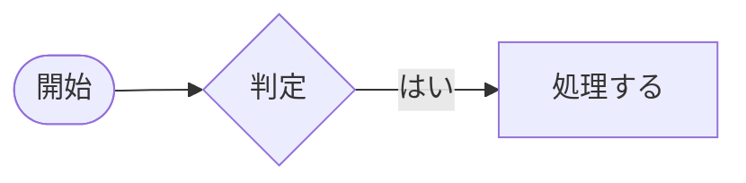

# Typball

Typst のプレビュー付きタブエディタです。中央でソースを編集すると、右のプレビューが即座に更新され、
左のアウトラインには見出しが並びます。Markdown もプレビューでき (画像・表・コードの色付け)、
Hugo などのサイトのプロジェクト内なら開発サーバーの表示をそのまま確認できます。`.txt` も開けるので
普段使いのテキストエディタとしても使えます。

Windows / macOS / Linux で動くネイティブアプリで、Windows の日本語入力 (IME) をそのまま使えます。

## 主な機能

| | |
|---|---|
| Typst | [Typst](https://typst.app/) 0.15 を内蔵しているので、ネットワークや別途のインストールは不要です。日本語フォント Noto Sans JP も内蔵しているため、どの OS でも同じ見た目で組めます。PDF に書き出せます |
| Markdown | 表・脚注・タスクリスト・GFM アラート・コードの色付け・画像・Mermaid の図に対応したプレビュー。エディタとプレビューのスクロールが連動します |
| サイトモード | Hugo などのプロジェクト内の `.md` を開くと開発サーバーを起動し、実際のサイトの見た目でプレビューします。保存すると更新されます |
| 図 | フローチャートなどの図を描くエディタを内蔵しています (図形・矢印・文字・色・整列)。図のファイル (`.tbdg`) の中身は SVG なので、Typst の文書に `#image("図.tbdg")` でそのまま貼れ、あとから開いて描き直せます。Markdown に貼る Mermaid のフローチャートを図から作るモード、機器のアイコンを線で結んで結線表を作れるネットワーク図のモード、スイッチのポートの割り当てを書くポート図のモードもあります |
| エディタ | 日本語対応の等幅フォント UDEV Gothic を内蔵 (半角と全角が 1:2 で桁がそろう)。Typst と Markdown の構文の色分け (Markdown は ```` ```rust ```` のように言語を書いたコードブロックの中も)、行番号 (左・右・両側)、ルーラー、折り返し (なし / ウィンドウの右端 / 指定文字数)、対応括弧の強調、編集した行の強調 (未保存はオレンジ、保存済みは青)、不可視文字の記号表示 (表示 > 記号を表示: 改行は CRLF・LF・CR で形の違う矢印、ファイルの終わり [EOF]、空白・タブ・全角空白。打ち込んだ文字と紛れないように図形で描きます。新規文書の改行コードと違う改行は種類ごとに色を変えて強調) |
| 検索・置換 | 入力に合わせて探すインクリメンタル検索。大文字小文字の区別・単語単位・正規表現、すべて置換 |
| アクション | 太字・斜体・見出し・コード・リンク・箇条書きなどを、エディタ上部のボタンやメニューから付け外しできます |
| タブとウィンドウ | 1 つのウィンドウに複数のタブ。タブをウィンドウの外へドラッグすると新しいウィンドウになり、別のウィンドウへも移せます |
| ペイン | アウトライン・プレビュー・コンソールを、エディタの左・右・下のどこにでも置けます。折りたたみや別ウィンドウへの切り離しもできます |
| プレビューウィンドウ | エディタ無しで、プレビューだけを表示するウィンドウでも開けます |
| ファイル | `.typ` / `.md` / `.txt` / `.tbdg` (図)。ウィンドウへのドラッグ&ドロップで開けます。ほかのアプリで書き換えられたファイルは、確認してから読み直します。Shift_JIS / EUC-JP / UTF-16 などの文字コードも判定して、同じ文字コード・同じ改行コードのまま保存します (保存時の文字コードと改行コードは「名前を付けて保存」のダイアログで選べます。読み間違えたときは ファイル > 文字コードを指定して開き直す)。改行コード (CRLF / LF / CR) は 編集 > 改行コード でも変換でき、今の改行コードはステータスバーの右端に出ます (新規文書の改行コードと違うときは太字、改行コードが混ざっているときは「混在」の警告)。新規文書の改行コードは 設定 > ファイル で選べます (初期値は OS の標準) |
| 壊れにくい保存 | 一時ファイルに書き終えてから入れ替えるので、保存中に USB メモリが外れても元のファイルは残ります (保存先に一時ファイルを作りたくなければ、設定で直接書き込みにも切り替えられます)。応答の無いドライブで固まらず、未保存の文書は数秒ごとに控えを取って、落ちても次の起動で復元します |
| 自動更新 | 新しい版が出ると知らせ、Windows ではダウンロードから再起動まで自動で行います |
| 表示言語 | 日本語 / 英語 (既定は OS の言語に合わせます) |

## ダウンロード

[Releases](https://github.com/Typball/Typball/releases) から OS に合ったファイルを取得してください。

| OS | ファイル | 使い方 |
|---|---|---|
| Windows | `typball-<ver>-windows-x86_64-setup.exe` | インストーラー。管理者権限は不要です。`.typ` / `.md` / `.tbdg` (図) の関連付けとスタートメニューへの登録ができます (関連付けは後から 設定 → 関連付け でも変えられます) |
| Windows | `typball-<ver>-windows-x86_64.zip` | 展開した `Typball.exe` をそのまま実行します (インストール不要) |
| macOS | `typball-<ver>-macos-aarch64.tar.gz` (Apple Silicon) / `-macos-x86_64.tar.gz` (Intel) | 展開した `Typball.app` を「アプリケーション」へ。署名していないため、初回は右クリック →「開く」で起動してください |
| Linux | `typball-<ver>-linux-x86_64.tar.gz` | 展開した `Typball` を実行します (GTK3 が必要です) |

Windows の Markdown プレビューには Microsoft Edge WebView2 ランタイムを使います。Windows 11 には標準で入っています。
入っていない場合は、インストーラーが導入を案内します。

## 使い方

### 基本

- 新しいファイルは「ファイル → 新規」(Ctrl+N) で作ります。Typst は A4・Noto Sans JP・日本語の設定と見出し 1 つの雛形から始まります
  (雛形は 設定 → ファイル で変えられます)。
- ファイルはメニューから開くほか、ウィンドウのどこへドラッグ&ドロップしても開けます。
- プレビュー・アウトライン・コンソールは「表示」メニューで出し入れします。ペインのヘッダの ▾ メニューやドラッグで、
  左・右・下へ置き場を変えられます。
- コンソールには Typst のエラーや警告が出ます。`行:桁` の付いた行をダブルクリックすると、その行へ移動します。
- Typst は「アクション → PDF に書き出し」(Ctrl+E) で PDF にできます。

### 図を描く

「ファイル → 形式を選んで新規 → 図 (.tbdg)」で、図のタブが開きます。

- 左のパレットの図形をクリックすると画面の中央に、ドラッグするとその位置に置けます (図形の中心を掴んで運びます)。
- 図形にマウスを重ねると、縁に接続点 (小さな丸) が出ます。接続点から別の図形までドラッグすると、線でつながります
  (図形を動かしても線は付いてきます)。相手の図形の中で離すと、図形全体につながります。
- 文字は、図形をダブルクリックするか、選んで F2 (または Enter) を押して入力します。図形の幅で自動的に折り返されます。
  図形の外をクリックすると確定します。
- 色・線の太さと種類・文字の大きさ・矢印の形・線の引き方 (直角 / 直線 / 曲線) は、上のツールバーで選んだ図形や線に付けます。
  線を選んでいないときの線の設定は、次に引く線に使われます。
- **グリッド**: 図形は、動かすときも大きさを変えるときも 10 px のグリッドに吸着します (ツールバーの「グリッド」で、表示と吸着をまとめて切り替えます)。動かしている間は、ほかの図形と端や中心がそろう位置にガイド線が出ます。
- **整列と等間隔**: 図形を 2 つ以上選んでツールバーの「整列」から、左・左右中央・右・上・上下中央・下にそろえられます。3 つ以上選ぶと、左右か上下に等間隔で並べられます (図形と図形の隙間が同じになります)。
  どちらも、動かした先は必ずグリッドに乗ります (手で動かした図形と同じ位置にそろいます)。そのため、幅の違う図形を中央でそろえたときなどは、ぴったりの位置から最大 5 px ずれることがあります。グリッドを切ると、ぴったりの位置に置きます。
- 右クリックで、切り取り・コピー・貼り付け・複製・重なり順・グループ化のメニューが出ます。コピーした図形は、ほかの図のタブにも貼れます。
- 画面の移動は、マウスホイール (Shift で左右)・右ボタンか中ボタンのドラッグ・スペースを押しながらのドラッグ。
  拡大と縮小は Ctrl+ホイールです。

図のファイル (`.tbdg`) の中身は SVG です。Typst の文書からは画像として読めます (図を保存すると、開いている Typst のプレビューにも反映されます)。

```typ
#figure(image("flow.tbdg", width: 80%), caption: [処理の流れ])
```

- 図の文字は、Typball が内蔵している Noto Sans JP で描かれます (Typst の文書に貼ったときも、エディタと同じ見た目になります)。
- 編集用のデータは SVG の中 (`<metadata>`) に入っています。ほかのアプリで書き換えるとこのデータが消えることがあり、
  その場合は図として開けなくなります (内容を守るため、編集できない状態で開きます)。
- Typball 以外 (Typst の CLI など) でもそのまま画像として読めますが、文字のフォントはその環境の Noto Sans JP
  (無ければ既定のフォント) になります。

図には 4 つのモードがあり、ツールバー左端の「モード」で切り替えます (モードは図のファイルに保存されます)。

| モード | 向いている図 |
|---|---|
| 自由な図 | 上に書いた、何でも描けるモード |
| 簡略図 (Mermaid) | Markdown や Typst に貼る Mermaid のフローチャート。配置は自動 |
| ネットワーク図 | 機器のアイコンを線で結ぶ図と、結線表 |
| ポート図 | スイッチ 1 台ごとの、ポートの並びと割り当ての表 |

「自由な図」「ネットワーク図」「ポート図」は、行き来しても図の中身は変わりません (変わるのは、パレットとツールバー、下の欄、使える操作だけです。ポートの割り当てなどの書き込みも残ります)。「簡略図 (Mermaid)」へ切り替えるときだけ、Mermaid で表せないものを変換し (何が変わるかを確認してから)、図形を自動で並べ直します。どの切り替えも「元に戻す」で戻せます。

図のファイルの形式は [spec/tbdg-format.md](spec/tbdg-format.md) に書いてあります。

#### Mermaid のフローチャートを作る (簡略図 (Mermaid) モード)

Markdown や Typst の文書に貼る [Mermaid](https://mermaid.js.org/) のフローチャートを、図を描いて作れます。
「モード」を「簡略図 (Mermaid)」にすると、画面の下に Mermaid の記述が出て、図を変えるたびに更新されます。
「コピー」で記述だけを、「コードブロックでコピー」で ```` ```mermaid ```` のコードブロックごとクリップボードに入れます
(コードブロックは、Markdown にも Typst にもそのまま貼れます。[文書の中に Mermaid を書く](#文書の中に-mermaid-を書く))。

Mermaid は図形の位置を自分で決め、使える図形や線も決まっているので、このモードでは操作をその範囲に絞ります。

- 図形は Mermaid にあるものだけ (四角形・角丸・端子・円・二重円・ひし形・六角形・平行四辺形・台形・定義済み処理・円柱)。
- 配置は自動です (流れの向きは「上から下 / 左から右 / 下から上 / 右から左」から選びます)。図形は手では動かせません。
  まだ線でつないでいない図形は、流れの向きに順に並びます (上から下なら縦に 1 列)。順につないでいく間、図形はほとんど
  動きません。貼った先の Mermaid は、つながっていない図形を横に並べて描きます (つなげば同じ形になります)。
- 線が図形のどこに付くかは、選べません (Mermaid が決めます。ひし形から出る「はい」「いいえ」の線も、行き先に近い辺に付きます)。
  線の出る場所を決めたい図は、「自由な図」で描きます。
- 線は、図形の中からドラッグして別の図形へ引きます。何も無い所で離すと、同じ形の新しい図形ができてつながります
  (そのまま文字を打てます)。元の図形の上で離したときは、何も起きません (自分自身につなぐ線は作れません)。
  図形を消すと、つながっている線も一緒に消えます。線の端は「なし / 矢印」、種類は実線・点線 (破線)・太線 (3 px 以上) が Mermaid の書き方になります。
- 塗り・線・文字の色は、既定 (白地に黒) から変えたものだけ `style` として書き出します。変えなければ、貼った先の Mermaid の配色になります。
- 文字の大きさや太字・重なり順・整列・グループ・回転・サブグラフはありません。

自由な図をこのモードに切り替えると、Mermaid で表せない要素は変換されます (Mermaid に無い図形は四角形に、
図形につながっていない線は削除、枠やグループは解除)。変換があるときは先に確認が出て、「元に戻す」(Ctrl+Z) で切り替える前に戻せます。
このモードの図も `.tbdg` (SVG) なので、Typst にはそのまま貼れます。

#### ネットワーク図を描く (ネットワーク図モード)

「モード」を「ネットワーク図」にすると、パレットに機器のアイコン (ルーター・L2 / L3 スイッチ・ファイアウォール・
無線 LAN・サーバーなど) が並び、画面の下に結線表が出ます。配置は自由で、自由な図と同じ操作ができます。

- **絵柄**: パレットの上の一覧で選びます。簡単な図には「記号 (単色)」、見栄えのよい図には「記号 (丸)」「記号 (四角)」「立体」。
  記号の 3 つは、ツールバーの「線の色」でアイコンの色を変えられます。1 つの図に絵柄を混ぜてもかまいません。
- **機器の名前**: アイコンを選んで F2 (またはダブルクリック) で入力します。絵の下に出ます。1 行目が機器の名前で、
  IP アドレスなどは 2 行目以降に書きます (Enter で改行)。
- **線**: 機器にマウスを重ねると出る丸い印 (→) からドラッグして、相手の機器で離します。線は機器どうしをまっすぐ結び、
  矢印は付きません。線の太さ・色・破線は、ツールバーで変えられます (速度や無線・VPN の区別に)。
- **ポート名**: 線を 1 本選ぶと、ツールバーの右に欄が 2 つ出ます (どちら側の機器かは、欄に薄く表示されます)。
  入力すると線の両端に出て、機器を動かしても付いてきます。線の上をドラッグして位置を変えられます。
- **メモ**: 線をダブルクリックして入力した文字 (「10G」「trunk」など) は線の中央に出て、結線表の「メモ」に入ります。
- **結線表**: 線でつないだ機器とポートの一覧です (機器 / ポート / 接続先 / ポート / メモ)。右の一覧で
  Markdown の表・Typst の表・CSV を選び、「コピー」でクリップボードに入れます。図を変えるたびに更新されます。
- 拠点やラック、VLAN の囲みには、パレットの下の「枠」や四角形を使います。

アイコンの絵は図のファイルの中に入るので、ほかの PC や、アイコンを収録していない版の Typball で開いても同じ絵が出ます。

#### スイッチのポートを書く (ポート図モード)

スイッチ 1 台ごとに、ポートの並んだ図と、ポートごとの割り当て (設定で使うポート名・接続先・VLAN・速度・メモ) を書くためのモードです。
ネットワーク図が「機器どうしのつながり」を描くのに対して、こちらは「このスイッチのどのポートに何がつながっているか」を書きます。

- **スイッチを置く**: パレットの「スイッチ - 8ポート」のような見出しの下から、ひな形を選びます。ポートの数は 5 / 8 / 12 / 16 / 24 / 48 で、それぞれに 1 段 (横並び)・2 段・右側に SFP の付いたものがあります (絵にマウスを重ねると名前が出ます)。
  上の段が奇数、下の段が偶数のポート番号で並びます。スイッチの名前は、上の帯を選んで F2 で変えます。
- **番号の並び順**: 2 段のスイッチは、機種によって番号の並びが違います。次の 4 つから選べます。
  パレットの「番号の並び順」は、これから置くスイッチの並び順です (選んだものは次に開いたときも残ります)。

  | 並び順 | 上の段 | 下の段 |
  |---|---|---|
  | 上下に交互 (上が奇数) | 1, 3, 5, … | 2, 4, 6, … |
  | 上下に交互 (下が奇数) | 2, 4, 6, … | 1, 3, 5, … |
  | 段ごと (上の段から) | 1, 2, 3, … | 13, 14, 15, … (24 ポートの場合) |
  | 段ごと (下の段から) | 13, 14, 15, … | 1, 2, 3, … |

- **置いた後で変える**: スイッチ (か、その中のポート) を選ぶと、表の上の欄で**ポートの数・SFP の数・段 (1 段 / 2 段)・並び順**を
  変えられます。ひな形に無い数 (10 ポート、28 ポートなど) も、ここで数を打てば作れます。
  並び順を変えると、番号と一緒に、接続先などの書き込みや色も新しい場所へ動きます。ポートを減らすと、番号の大きい方から消えます。
  番号は振り直されますが、自分で書き換えた番号はそのまま残ります。
- **番号の始まり**: 外観の番号が 0 から始まる機種は、「番号」の「開始」を 0 にします。SFP の番号は、空なら RJ-45 の続き、
  数を入れるとそこから振り直します。
- **ポート名 (設定で使う名前)**: 外観の番号とは別に、設定で使う名前 (「Gi1/0/1」など) を「ポート名」の列に持てます。
  「ポート名」の欄に番号の前の部分 (「Gi1/0/」) を入れると、全部のポートに「Gi1/0/1」「Gi1/0/2」… と入ります。
  外観の番号と始まりの数が違う機種もあるので、ポート名の「開始」は別に決められます (「ge-0/0/0」のような機種は 0)。
  SFP は、名前の前の部分と始まりの数を別に入れられます (「Te1/1/」で 1 から、など。空なら RJ-45 と同じ名前で続きの番号)。
  1 つずつ違う名前にしたいポートは、表の「ポート名」の欄を直接書き換えます (書き換えた名前は、振り直しても残ります)。
- **ポートの一覧**: 画面の下に、ポートごとの表が出ます。**表に直接書き込めます** (Tab で右の欄、Enter で下の行へ)。
  行を選ぶと図のポートも選ばれ、図でポートを選ぶとその行に印が付きます。「ポート」の欄を書き換えると、図の番号も変わります
  (「Gi1/0/1」のような名前にもできます)。
- **爪の向き**: RJ-45 のポートの爪 (切り欠き) の向きは、表の上の「爪」で選びます (下向き / 上向き / 上の段は上・下の段は下 / 上の段は下・下の段は上)。1 つずつ変えたいときは、ポートを選んでツールバーの「爪の向きを変える」を押します (変えたポートは、あとで「爪」を選び直してもそのまま残ります)。
- **色分け**: ポートを選んで、ツールバーの「塗りの色」で色を付けられます (VLAN ごとに色を変える、使用中に色を付ける、など)。
- **ポートを 1 つずつ足し引きする**: パレットの「ポート (RJ-45)」「ポート (SFP)」をスイッチの中へドラッグすると足せます。要らないポートは Delete で消せます (手で動かしたポートは、上の欄で数や並び順を変えると、並べ直されます)。
- **表を文書に貼る**: 右の一覧で Markdown の表・Typst の表・CSV を選んで「コピー」。スイッチが 2 台以上あるときは、表に「スイッチ」の列が付きます。
- 線でつなぐ操作はありません (ポートどうしの配線は、ネットワーク図か自由な図で描きます)。

| キー | 操作 |
|---|---|
| Delete | 選んだ図形や線を削除 |
| 矢印キー / Shift+矢印キー | 選んだ図形をグリッド 1 つ分 / 1 px 動かす |
| Ctrl+D | 複製 |
| Ctrl+G / Ctrl+Shift+G | グループ化 / グループ解除 |
| Ctrl+B / Ctrl+I | 文字を太字 / 斜体に |
| F2 / Enter | 文字を編集 (Esc で取り消し) |
| Esc | 選択を解除 |

### 文書の中に Mermaid を書く

Markdown と Typst の文書に、[Mermaid](https://mermaid.js.org/) の記述をコードブロックで書くと、プレビューで図になります
(フローチャートのほか、シーケンス図など Mermaid の図の種類が使えます)。

````markdown

````

- **Markdown**: プレビューと PDF の書き出しで図になります。HTML の書き出しでは、コードブロックのまま出ます。
  書き間違いがあるとコードブロックのまま残り、枠が赤くなります (マウスを重ねると理由が出ます)。
- **Typst**: 同じ書き方 (```` ```mermaid ````) で、プレビューでも PDF などの書き出しでも図 (ベクター画像) になります。
  開いた直後や書き換えた直後は、図が描けるまでの一瞬だけコードブロックのまま出ます。書き間違いの理由はコンソールに出ます。
  - 図の文字は、Typball が内蔵している Noto Sans JP で描かれます。
  - ページの幅に収まらない図は、幅に合わせて縮みます。
  - `#figure(…)` に入れると、番号の種類が「リスト」になります。図として数えたいときは `#figure(kind: image, …)` と書きます。
  - 文字を HTML で描く種類の図 (Mermaid の設定によります) は Typst では描けないので、コードブロックのまま出ます。
  - Typball の外 (Typst の CLI など) で組むと、コードブロックのまま出ます。図を PDF に残したいときは、Typball で書き出してください。
- どちらも、図を描くのに Microsoft Edge WebView2 ランタイムを使います (Windows 11 には標準で入っています)。
- 図を GUI で作りたいときは、図エディタの「簡略図 (Mermaid)」モードで描いて、記述をコピーして貼れます。

### キーボードショートカット

| キー | 操作 |
|---|---|
| Ctrl+N / Ctrl+O / Ctrl+S / Ctrl+Shift+S | 新規 / 開く / 上書き保存 / 名前を付けて保存 |
| Ctrl+W | タブを閉じる |
| Ctrl+Shift+N | 新しいウィンドウ |
| Ctrl+F / Ctrl+H | 検索 / 置換 |
| F3 / Shift+F3 | 次を検索 / 前を検索 |
| Ctrl+G | 指定行へ移動 |
| Ctrl+B / Ctrl+I | 太字 / 斜体 (Typst・Markdown) |
| Ctrl+E | PDF に書き出し (Typst) |
| Ctrl+1 / Ctrl+2 / Ctrl+3 | 折り返さない / 指定文字数で折り返し / ウィンドウの右端で折り返し |
| Ctrl+Shift+L / Ctrl+Shift+P / Ctrl+Shift+K | アウトライン / プレビュー / コンソールの表示切り替え |

macOS では Ctrl の代わりに ⌘ を使います。

### コマンドライン

```bash
Typball ファイル...                  # 開く (設定に従ってエディタかプレビューウィンドウで)
Typball --edit ファイル              # エディタで開く
Typball --view ファイル              # プレビューウィンドウで開く
Typball --new-instance ファイル      # 起動中の Typball に渡さず、別のプロセスで開く
```

Typball が起動しているときにファイルをダブルクリックすると、起動中の Typball のタブに入ります。
インストーラー版では、ファイルの右クリックメニューに「Typball で編集」「Typball でプレビュー」が加わります。

### 形式ごとのエディタ設定

「ツール → 設定 → エディタ」の値は、どの形式にも効く既定値です。Markdown だけタブ幅を 2 にする、テキストだけ折り返さない、
のように形式ごとに変えたいときは、「設定 → ファイル → (形式)」のいちばん上にある「エディタ設定を上書き」を押します。

- エディタのページと同じ項目が並びます。**チェックを入れた項目だけ**が、その形式で上書きされます。
  チェックの無い項目は選べず、既定値が見えるだけです (「エディタ」のページを変えると、一緒に変わります)。
- 上書きしている項目の名前は、ボタンの横に出ます。「すべて既定値に戻す」で、上書きをまとめてやめられます。
- 表示メニューの「折り返し」「行番号」「ルーラー」「記号を表示」などは、今のタブの形式で有効な値を見せます。
  切り替えると、その形式で上書きしている項目は上書きの値が、していない項目は既定値が変わります。
- 配色は、形式ごとには変えられません。図 (.tbdg) にはテキストのエディタが無いので、この設定はありません。

### 関連付け

「ツール → 設定 → 関連付け」で、`.txt` / `.md` / `.typ` / `.tbdg` (図) をダブルクリックしたときに Typball で開くよう OS に登録できます
(インストーラーを使わない zip 版でも、インストーラーと同じ登録ができます)。形式ごとに今の既定のアプリと Typball の登録状況が出て、
「関連付ける」「解除」はその場で反映されます。登録されるのは、そのとき動いている Typball です
(別の場所に置いた Typball が登録されているときは、その場所が表示され、「関連付ける」で付け替えられます)。

| OS | |
|---|---|
| Windows | ファイルに付くアイコンを、書類のアイコン / Typball のアイコン / 好きなファイル (`.ico` など) から選べます。Windows の設定で別のアプリを既定に選んである拡張子は、登録しただけでは既定のアプリが変わりません。「既定のアプリの設定を開く」から Typball を選んでください |
| macOS | その種類のファイルを開く既定のアプリを Typball にします (Finder の「このアプリケーションで開く → すべてを変更」と同じ)。`Typball.app` として起動しているときだけ使えます。解除するとテキストエディットに戻ります |
| Linux | `~/.local/share/applications/typball.desktop` と `~/.config/mimeapps.list` に登録します。ファイルのアイコンはデスクトップのアイコンテーマで決まります |

### 設定

設定は「ツール → 設定」で変更します。内容は `Settings.toml` という 1 つのファイルに保存されます。

| 場所 | |
|---|---|
| 実行ファイルと同じフォルダ | `Settings.toml` を置くと、そちらが優先されます (USB メモリでの持ち運びや、PC 間の移行に) |
| Windows | `%APPDATA%\Typball\Settings.toml` |
| macOS | `~/Library/Application Support/Typball/Settings.toml` |
| Linux | `~/.config/Typball/Settings.toml` |

使っているファイルの場所は、設定ダイアログの下部に表示されます。ファイルに無い項目は既定値で補われるので、
版をまたいでそのままコピーできます。直接編集する場合の項目は次のとおりです。

```toml
[general]
language = "system"   # "system" / "ja" / "en"
last_tab = "close_window"   # 最後のタブを閉じたとき: "keep_empty" (空のタブを残す) / "close_window" (ウィンドウを閉じる。最後のウィンドウなら終了)
show_toolbar = true         # メニューの下にツールバーを表示する (表示メニューの「ツールバー」と同じ)

[editor]
font_face = "UDEV Gothic"   # 既定は同梱の等幅フォント UDEV Gothic (未インストールでも使える)。エディタの中身だけに効く (ルーラー・行番号・コンソール・タブなどの UI は OS の既定 GUI フォント)
font_size = 12
line_spacing = 1            # 行間: 1 行の高さに足す px (0 でフォントの行の高さのまま)
tab_width = 4               # タブ幅 (半角の文字数)
use_tabs = false            # Tab キーでタブ文字を入力する (false は次のタブ位置までのスペース)
backspace = "soft_tab"      # Backspace でスペースを消すとき: "char" (1 個ずつ) / "soft_tab" (タブ位置で、その前がタブ幅ぶんスペースのときだけまとめて) / "tab_stop" (タブ位置にあるとき、続いているスペースをタブ幅ぶんまで) / "full_tab_stop" (前のタブ位置までスペースだけのとき、そこまで) / "to_tab_stop" (前のタブ位置まで、続いているスペースを) / "indent" (行頭の字下げだけ、前のタブ位置まで)
wrap = "window"             # 折り返し: "none" / "window" (ウィンドウの右端) / "column" (指定文字数)
wrap_column = 80            # wrap = "column" のときの文字数
line_numbers = "left"       # "none" / "left" / "right" / "both"
highlight_changes = true    # 編集した行を強調する (未保存はオレンジの帯 + 太字の行番号、保存済みは青の帯)
saved_changes = "keep"      # 保存したとき: "keep" (色を変えて残す) / "clear" (強調を消す)
show_ruler = true           # エディタ上部にルーラーを表示する
ruler_tabs = "arrow"        # ルーラーでのタブ位置の示し方: "none" (目盛りだけ) / "arrow" (小さな矢印)
show_eol = true             # 改行を矢印で表示する (CRLF は折れた矢印、LF は ↓、CR は ←。新規文書の改行コードと違うものは色を変える)
show_eof = true             # ファイルの終わりに [EOF] を表示する
show_whitespace = true      # 空白・タブ・全角空白を記号で表示する

[files]
default_filetype = "txt"    # 新規タブ (Ctrl+N) の形式: "txt" / "md" / "typ"
external_change = "ask"     # 外部で変更されたとき: "ask" (確認) / "reload" (自動で読み直す) / "ignore"
untitled_numbering = true   # 新規文書の名前に番号を付ける ("無題-1.txt"。false なら "無題.txt")
default_encoding = "utf-8"  # 新規文書の文字コード: "utf-8" / "utf-8-bom" / "utf-16le" / "utf-16be" / "shift_jis" / "euc-jp" / "iso-2022-jp" など
default_line_ending = "auto" # 新規文書の改行コード: "auto" (OS の標準) / "crlf" / "lf" / "cr"
fallback_encoding = "auto"  # UTF-8 として読めないファイルの文字コード ("auto" は内容から推定)
large_file_mb = 16          # これを超える大きさのファイルは確認してから、色分け・編集行の強調・アウトライン・プレビューを止めて開く (0 で無効)
max_file_mb = 256           # これを超える大きさのファイルは開かない (0 で無制限)
save_method = "atomic"      # 保存のしかた: "atomic" (一時ファイルに書いてから入れ替える) / "direct" (元のファイルに直接書き込み、保存先に一時ファイルを作らない)
recovery_backup = true      # 未保存の文書を数秒ごとに控えて、落ちたときに次の起動で復元する

[filetypes.typ]             # 形式ごとに、開いたときに表示するペインとバー (書かない項目は形式の既定値)
show_outline = true
show_preview = true
show_console = true         # コンソール (Typst の診断 / Markdown の変換結果 / 開発サーバーの出力)
show_actionbar = true
sync_scroll_to_preview = true   # エディタをスクロールしたらプレビューも追従 (Markdown のプレビューのみ対応)
sync_scroll_to_editor = true    # プレビューをスクロールしたらエディタも追従 (エディタを動かしたくなければ false)
open_mode = "editor"        # ファイルを渡されて起動したとき (ダブルクリック): "editor" / "viewer" (プレビューウィンドウ)。--edit / --view が優先
template = """           # 新しいファイル (Ctrl+N / 起動時の新規タブ) の雛形。無ければ言語ごとの既定 (下の内容)
#set page(paper: "a4")
#set text(font: "Noto Sans JP", lang: "ja", size: 12pt)

= 新しい文書

"""
[filetypes.typ.pane_sizes]  # ペインの大きさ (px)。分割線を動かすと形式ごとに保存される (左右の置き場は幅、下は高さ)
left = 200
right = 460
bottom = 110
[filetypes.md]
show_outline = true
show_preview = true
show_actionbar = true
[filetypes.txt]
show_outline = false
[filetypes.md.editor]       # 形式ごとのエディタ設定の上書き。[editor] と同じ項目を、変えたいものだけ書く (書かない項目は [editor] の値)
tab_width = 2               # Markdown だけタブ幅を 2 にする
[filetypes.tbdg]            # 図。ペインや雛形は無く、使うのは開き方だけ
open_mode = "editor"

[panes]                     # ペインの置き場: "left" / "right" / "bottom" (ヘッダの ▾ メニューかドラッグで変わる)
outline = "left"
preview = "right"
console = "bottom"
bottom_width = "editor"     # 下の置き場の幅: "editor" (エディタの幅) / "window" (ウィンドウの幅いっぱい)

[preview]                   # プレビュー
font_face = "Noto Sans JP"  # プレビューの既定フォント: Typst は文書が #set text(font:) で指定しないときの既定、Markdown の本文、プレビューウィンドウ。同梱の Noto Sans JP は未インストールでも使える
font_size = 12              # 同じくサイズ (pt)
tab_width = 4               # プレビューのタブ幅 (半角の文字数): プレビューウィンドウのテキスト表示と Markdown のコード。エディタの tab_width とは別
markdown_mode = "auto"      # "auto" (サイトのプロジェクト内ならサイトモード) / "markdown" / "site"
site_command = "hugo server -D -N -M --port {port} -s {root}"   # 開発サーバーのコマンド ({port} は空きポート、{root} はプロジェクトのフォルダ)
site_url = "http://localhost:{port}/"                            # 表示する URL

[instance]                  # Typball をもう一度起動したとき
mode = "single"             # "single" (起動中の Typball にファイルを渡す。--new-instance で一時的に別プロセス) / "multiple" (起動のたびに別プロセス)

[update]                    # 更新の確認 (GitHub Releases)
check_on_startup = true     # 起動時に新しい版が公開されていないか確認する
channel = "stable"          # "stable" (番号付きの Release だけ) / "nightly" (push ごとの開発版も含める)
interval_hours = 24         # 確認の間隔 (時間)
last_check = 0              # 最後に確認した時刻 (UNIX 秒、自動で更新される)
skipped_version = ""        # 「この版はスキップ」を選んだバージョン

[window]              # 終了時に自動保存され、次回起動時に復元される (初回は画面の縦横半分の大きさで中央に出る)
width = 1200          # 幅と高さは拡大率 100% 換算
height = 800
x = 100               # 位置は画面の座標。タイトルバーがどの画面からも掴めない位置のときだけ、画面の中へ戻す
y = 100
```

### 更新

起動時 (既定で 24 時間に 1 回) と「ヘルプ → 更新を確認」で、新しい版が公開されていないか確かめます。
Windows では「更新して再起動」を選ぶと、ダウンロード・入れ替え・再起動まで自動で行い、開いていたファイルを開き直します。
macOS / Linux では新しい版を知らせ、ダウンロードページを開きます。設定 → 更新 で、開発版 (nightly) も受け取るようにできます。

## ビルド方法

### Windows (ワンクリック)

リポジトリ直下の [`build.cmd`](build.cmd) をダブルクリックするか、ターミナルで実行すると `dist\Typball.exe` ができます。
足りない開発ツールは自動的にインストールします。初回は wxWidgets をソースからビルドするため 10 分以上かかります。

```bat
build.cmd
```

| 必要なもの | 導入方法 (無い場合は build.cmd が実行) | 備考 |
|---|---|---|
| Rust | `winget install Rustlang.Rustup` | その後 `stable-x86_64-pc-windows-gnu` ツールチェーンを追加 |
| C/C++ コンパイラ・CMake・make・libclang | Code::Blocks 25.03 公式インストーラー (`codeblocks-25.03mingw-setup.exe`) | 同梱の MinGW-w64 (GCC 14, UCRT) を `C:\Program Files\CodeBlocks\MinGW\bin` で使う |
| CMake (予備) | `winget install Kitware.CMake` | 見つかった MinGW に cmake.exe が無い場合のみ |
| libclang (予備) | `winget install LLVM.LLVM` | 見つかった MinGW に libclang.dll が無い場合のみ |

winget にある Code::Blocks (`CodeBlocks.CodeBlocks.MinGW`) は zip を展開するポータブル版で、入る場所が
`%LOCALAPPDATA%\Microsoft\WinGet\Packages\...` と分かりにくいため使いません。
Windows ヘッダーが古い MinGW (例: Code::Blocks 20.03 同梱の GCC 8.1。wxWidgets の Direct2D 描画に必要な定義が無い) は
小さなテストのコンパイルで判定して使いません。使える MinGW が無ければ次の順で用意します。

1. 古い Code::Blocks (`C:\Program Files\CodeBlocks`) があれば、上書きすると古い MinGW のファイルが混ざるので先にアンインストールします。
   実行前に確認が出て、30 秒で自動的に進みます (N で残す)。
2. SourceForge から `codeblocks-25.03mingw-setup.exe` (約 423 MB) を取得し、公式の `checkums.txt` に載っている SHA-256 と照合してから、
   `/S` で黙ってインストールします。管理者権限の確認 (UAC) が出ます。取得したファイルは `%TEMP%` に置き、
   途中で止めても照合に通るものだけを次回に使い回します。
3. UAC を拒否した・管理者権限が無い・1. で残した場合は、Code::Blocks 25.03 / CI と同じ WinLibs の zip を GitHub から取得し
   (SHA-256 を照合)、`%LOCALAPPDATA%\Typball\winlibs` に展開して使います。

CMake は使った MinGW のフルパスを `target\<profile>\wxdragon_sys_cmake_build` のキャッシュに記録します。
前回と違う MinGW でビルドすると (例: WinLibs → Code::Blocks)、build.cmd はこれを見つけて
`wxdragon_sys_cmake_build` と `wxwidgets_cmake_build` を消してから cargo を呼びます。wxWidgets は再びコンパイルされます。

build.cmd のメッセージは英語です。cmd.exe は非 ASCII 文字を含むバッチで行の位置を誤り、続く行の断片を実行することがあるため、
ファイル全体を ASCII に保っています。

| 環境変数 | 値 | 意味 |
|---|---|---|
| `TYPBALL_TOOLCHAIN` | `gnu` (既定) / `msvc` | `msvc` にすると Visual Studio 2022 Build Tools (C++) を使い、無ければ winget で導入します |
| `TYPBALL_MINGW_DIR` | パス | `gcc.exe` / `g++.exe` のあるフォルダを指定する (ヘッダーが古くても警告だけ出してこれを使う) |
| `TYPBALL_PROFILE` | `debug` | debug ビルドにする (既定は release) |
| `TYPBALL_DRY_RUN` | `1` | インストールとビルドを実行せず、実行するコマンドを表示するだけにする |

### 手動でビルドする

```bash
cargo build --release
```

- **Windows (MinGW)**: `rustup toolchain install stable-x86_64-pc-windows-gnu` の上で、gcc / g++ / cmake / mingw32-make / libclang
  (Code::Blocks 同梱の MinGW で可) を PATH に通し、`RUSTUP_TOOLCHAIN=stable-x86_64-pc-windows-gnu` を付けてビルドします。
- **Windows (MSVC)**: Visual Studio Build Tools (C++)・CMake・LLVM (libclang) を入れれば、既定の MSVC ツールチェーンでもビルドできます。
- **macOS**: Xcode Command Line Tools と CMake (`brew install cmake`)。
- **Linux (Debian / Ubuntu)**:
  ```bash
  sudo apt-get install build-essential cmake pkg-config libclang-dev \
    libgtk-3-dev libpng-dev libjpeg-dev libtiff-dev libexpat1-dev zlib1g-dev \
    libgl1-mesa-dev libglu1-mesa-dev libxkbcommon-dev libwayland-dev \
    libxtst-dev libsm-dev libice-dev libnotify-dev \
    libwebkit2gtk-4.1-dev libsoup-3.0-dev
  ```

初回のビルドでは wxWidgets のソース (約 230 MB。Windows は WebView2 SDK も) をダウンロードするため、ネットワーク接続が必要です。
実行ファイルは `target/release/Typball` (Windows は `Typball.exe`) にできます。

## ライセンス

Typball 本体は [MIT License](LICENSE) です。

実行ファイルには次のフォントとソフトウェアが含まれており、それぞれのライセンスに従います。
ライセンスの全文は [THIRD-PARTY-NOTICES.txt](THIRD-PARTY-NOTICES.txt) にまとめてあり、配布物 (zip・インストーラー・
macOS / Linux のアーカイブ) にも同梱しています。アプリでは ヘルプ → バージョン情報 →「License」で一覧を確認できます。

| 含まれるもの | ライセンス |
|---|---|
| Noto Sans JP (Regular / Bold)。© 2014-2021 Adobe | SIL Open Font License 1.1 |
| UDEV Gothic (Regular / Bold)。© 2022 Yuko OTAWARA。BIZ UDゴシック (© 2022 The BIZ UDGothic Project Authors) と JetBrains Mono (© 2020 The JetBrains Mono Project Authors) の合成 | SIL Open Font License 1.1 |
| Typst 同梱フォント: Libertinus Serif | SIL Open Font License 1.1 |
| Typst 同梱フォント: New Computer Modern / NewCM Math | GUST Font License 1.0 (NewCM10-Regular は GPL-3.0 以降 + Font Exception + Distribution Exception) |
| Typst 同梱フォント: DejaVu Sans Mono | Bitstream Vera / Arev Fonts License (DejaVu の変更部分はパブリックドメイン) |
| Typst 同梱の PDF 標準フォント (Foxit) | BSD-3-Clause |
| Typst 同梱のデータ (ICC プロファイル、HTML / MathML のデータ) | CC0 1.0 / CC BY 4.0 / BSD-3-Clause / W3C Document License |
| [Typst](https://github.com/typst/typst) | Apache License 2.0 |
| [wxWidgets](https://www.wxwidgets.org/) | wxWindows Library Licence 3.1 |
| wxWidgets に内蔵: Scintilla / Lexilla | Scintilla License |
| wxWidgets に内蔵: libpng | PNG Reference Library License v2 |
| wxWidgets に内蔵: zlib・NanoSVG | zlib License |
| wxWidgets に内蔵: libjpeg (Independent JPEG Group) | IJG License |
| wxWidgets に内蔵: libtiff | libtiff License |
| wxWidgets に内蔵: Expat | MIT |
| wxWidgets に内蔵: PCRE2 | BSD-3-Clause (PCRE2 の例外付き) |
| Microsoft Edge WebView2 SDK | BSD-3-Clause |
| [maxGraph](https://github.com/maxGraph/maxGraph) (図エディタ)。© 2021-present The maxGraph project Contributors、© 2006-2015 JGraph Ltd、© 2006-2015 Gaudenz Alder | Apache License 2.0 |
| 図エディタのアイコン: [Affinity](https://github.com/ecceman/affinity) (ネットワーク機器の記号) | The Unlicense (パブリックドメイン) |
| 図エディタのアイコン: [isoflow](https://github.com/markmanx/isopacks) の立体アイコン。© 2023 Mark Mankarious | MIT |
| [Mermaid](https://github.com/mermaid-js/mermaid)。© 2014-2022 Knut Sveidqvist。同梱の 1 ファイル版には、Mermaid が使うライブラリも含まれます | MIT |
| Rust クレート (約 380 個。一覧と全文は THIRD-PARTY-NOTICES.txt) | MIT・Apache-2.0・Unicode-3.0・BSD・ISC・Zlib・MPL-2.0 など。選べるものは MIT (MIT の全文が無いものは Apache-2.0) で利用 |

This software is based in part on the work of the Independent JPEG Group.
